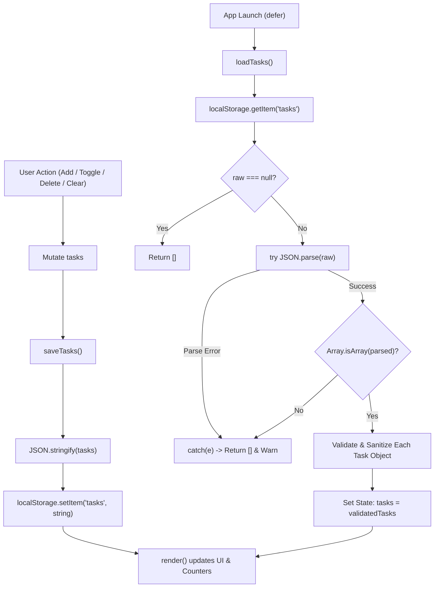

# Daylist — Interactive To-Do List with LocalStorage

> **InternCircle Fullstack Web Development — Project 02**
> A clean, modern, and responsive daily task manager built with HTML5,
> CSS3, and Vanilla JavaScript, featuring robust LocalStorage
> persistence, multi-criteria filtering, and WCAG AA accessible design.

---

## 📋 Overview

**Daylist** is designed to help users capture, organize, and complete daily
tasks seamlessly. Every user action is instantly synchronized with browser
`localStorage`, ensuring tasks persist across page reloads, browser
restarts, and tab closures without requiring any external libraries or
backend servers.

The application adheres strictly to modern web standards, semantic HTML5,
keyboard accessibility, and defenses against Cross-Site Scripting (XSS).

---

## ✨ Features

- **Task Management**
  - Add tasks instantly via the **Add** button or pressing `Enter`.
  - Strict input validation rejecting empty or whitespace-only submissions
    with clear visual error feedback.
  - Mark tasks complete with custom styled accessible checkboxes.
  - Undo task completion at any time with a single click.
  - Delete individual tasks with instant reactive DOM updates.

- **LocalStorage Data Persistence**
  - Serializes task data using `JSON.stringify()` on every update.
  - Deserializes stored tasks on application launch using `JSON.parse()`.
  - Comprehensive `try...catch` error guarding against corrupt JSON, invalid
    types, and restricted storage environments.
  - Schema validation pipeline to filter out malformed objects and sanitize
    data.
  - Fallback in-memory state if `localStorage` is disabled or blocked.
  - Multi-tab synchronization using the `storage` window event.

- **Productivity & Filtering Controls**
  - **All**, **Active**, and **Done** tabs with dynamic counter badges.
  - **Live Counter:** Real-time remaining active tasks counter with
    grammatically accurate pluralization (`1 task left` vs `X tasks left`).
  - **Clear Completed:** Single-click purge for all finished tasks
    (auto-hidden when no tasks are completed).
  - **Contextual Empty States:** Informative icons and friendly messages
    when no tasks exist for the current view.

- **Design & Accessibility**
  - Calming, professional visual identity with emerald green accents
    (`#059669`) and slate neutral tones.
  - 100% responsive across mobile (360px), tablet (768px), and
    desktop (1280px+).
  - High-contrast typography meeting WCAG AA requirements.
  - Full keyboard navigability with visible `:focus-visible` focus rings.
  - Zero dependencies — fast, lightweight, and pure vanilla frontend.

---

## 🛠️ Technologies Used

- **HTML5:** Semantic document structure (`<main>`, `<header>`, `<footer>`,
  `<form>`, `<ul>`, `<button>`, ARIA attributes).
- **CSS3:** Custom properties (CSS variables), Flexbox, CSS Grid, media
  queries, accessibility styling.
- **Vanilla JavaScript (ES6+):** Pure DOM manipulation, event listeners,
  event delegation, array methods (`filter`, `forEach`, `map`).
- **Browser Web Storage API:** `window.localStorage` with error handling
  and serialization.

---

## 📁 Project Structure

```text
InternCircle_Project02_Daylist/
├── index.html          # Semantic HTML5 markup and accessible structure
├── style.css           # Modern CSS3 styling, tokens, and media queries
├── app.js              # State management, LocalStorage, event logic
├── README.md           # Comprehensive project documentation
└── SUBMISSION-NOTE.txt # InternCircle project submission summary
```

---

## 🚀 How to Run the Project Locally

Because Daylist uses pure vanilla HTML, CSS, and JavaScript, no build steps
or package managers (`npm`/`yarn`) are required.

### Method 1: Using VS Code Live Server (Recommended)

1. Open the project folder in **Visual Studio Code**.
2. Install the **Live Server** extension by *Ritwick Dey* if not installed.
3. Right-click `index.html` in the explorer and select
   **"Open with Live Server"**.
4. The application will launch at `http://127.0.0.1:5500/index.html`.

### Method 2: Direct Browser Launch

1. Navigate to the project directory on your computer.
2. Double-click `index.html` (or right-click and select **Open with** >
   **Google Chrome** / **Microsoft Edge** / **Firefox**).
3. The app will open directly via the `file://` protocol.

### Method 3: Simple Python HTTP Server

```bash
# In the project directory, run:
python -m http.server 8000

# Open in your browser:
# http://localhost:8000
```

---

## 💾 How LocalStorage Works in Daylist

The browser `localStorage` mechanism provides synchronous key-value storage
that persists across sessions. In Daylist, data persistence follows a
secure, defensive 4-stage pipeline:



1. **State as Single Source of Truth:**
   The entire application state is stored in an array:

   ```javascript
   let tasks = [
     { id: 1731154800000, text: "Complete Project 02", done: false }
   ];
   ```

2. **Serialization & Saving (`JSON.stringify`):**
   `localStorage` only accepts string key-value pairs. Whenever state
   changes, `saveTasks()` serializes the array into JSON:

   ```javascript
   function saveTasks() {
     try {
       localStorage.setItem("tasks", JSON.stringify(tasks));
     } catch (error) {
       console.error("Storage error:", error);
     }
   }
   ```

3. **Deserialization & Loading (`JSON.parse`):**
   On application start, `loadTasks()` reads `"tasks"` from `localStorage`
   and converts the JSON string back into JavaScript objects.

4. **Defensive Validation & Corrupted Data Handling:**
   A corrupted string (e.g. manual tampering in DevTools or invalid format)
   is caught safely by a `try...catch` block:

   ```javascript
   try {
     const raw = localStorage.getItem("tasks");
     const parsed = JSON.parse(raw);
     if (!Array.isArray(parsed)) return [];
     return parsed.filter(t =>
       t && t.id && typeof t.text === "string" && t.text.trim().length > 0
     );
   } catch {
     return []; // Never crashes the app
   }
   ```

5. **XSS Protection (`textContent`):**
   User task text is always rendered using `element.textContent = task.text`.
   It is never interpolated into `innerHTML`, completely mitigating script
   injection or malicious payload execution.

---

## 🌐 Deploying to GitHub Pages

To make Daylist publicly accessible for your InternCircle submission:

1. **Initialize Git & Commit Files:**

   ```bash
   git init
   git add .
   git commit -m "feat: complete Daylist interactive to-do list"
   ```

2. **Link to GitHub Repository:**

   ```bash
   git branch -M main
   git remote add origin https://github.com/<user>/Interactive-To-Do-List-with-LocalStorage.git
   git push -u origin main
   ```

3. **Enable GitHub Pages:**
   - Go to your repository on GitHub.
   - Click on **Settings** (tab along the top).
   - In the left sidebar, click on **Pages**.
   - Under **Build and deployment** > **Source**, choose
     **Deploy from a branch**.
   - Under **Branch**, select `main` and folder `/ (root)`, then click **Save**.
   - Wait 1–2 minutes for the deployment workflow to finish.
   - Your website will be live at:
     `https://<user>.github.io/Interactive-To-Do-List-with-LocalStorage/`

---

## 🧪 Verification & Test Checklist

<!-- markdownlint-disable MD013 -->
| Scenario | Expected Result | Status |
| :--- | :--- | :---: |
| 1. Add task via button | Task added to top/bottom of list; input cleared | ✅ PASS |
| 2. Add task via Enter key | Form submits, adds task without page refresh | ✅ PASS |
| 3. Reject empty input | Shows inline error; prevents blank item creation | ✅ PASS |
| 4. Add multiple tasks | All tasks rendered dynamically in sequential order | ✅ PASS |
| 5. Mark task complete | Checkbox checked, text styled with line-through | ✅ PASS |
| 6. Undo completion | Task uncrossed, status toggles back to active | ✅ PASS |
| 7. Delete task | Item removed from DOM and array state immediately | ✅ PASS |
| 8. Filters (All/Active/Done) | Switches views accurately; shows correct badges | ✅ PASS |
| 9. Clear Completed | Purges all finished tasks; updates counter | ✅ PASS |
| 10. Remaining counter | Displays accurate active count with pluralization | ✅ PASS |
| 11. Refresh persistence | State matches exactly after page refresh / restart | ✅ PASS |
| 12. 10+ Tasks test | Scroll and interactions remain smooth and responsive | ✅ PASS |
| 13. Corrupted LocalStorage | Handled gracefully without breaking UI or freezing | ✅ PASS |
| 14. Responsive layouts | Flawless viewports at 360px, 768px, and 1280px | ✅ PASS |
| 15. Console errors | Zero uncaught exceptions or warnings | ✅ PASS |
<!-- markdownlint-enable MD013 -->

---

## 📄 License & Credits

Built as part of the **InternCircle Fullstack Web Development Internship**.
Developed with pride and precision by Shri Kavin D K.
